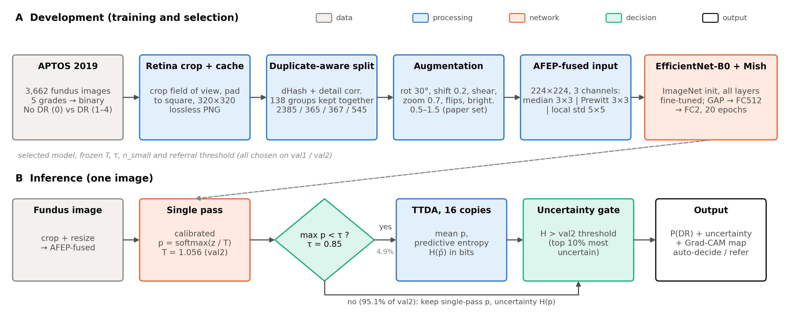
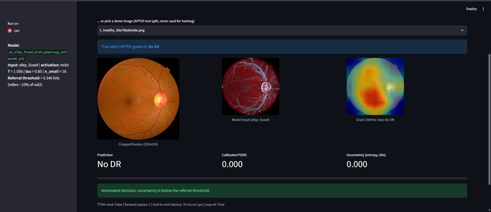
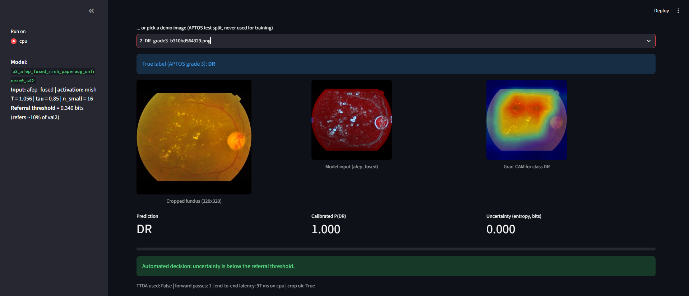
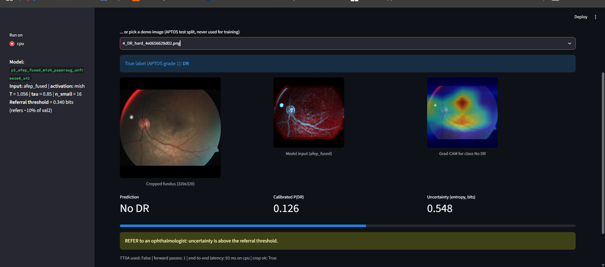

# TrustEye-Edge

**A leakage-aware re-evaluation of DR-TrustNet, with selective test-time augmentation and uncertainty-based referral for diabetic retinopathy triage.**

This project re-implements the **DR-TrustNet** pipeline ([Verma et al., 2026](https://doi.org/10.1016/j.imavis.2026.105921)) for binary *No DR* vs. *DR* classification of fundus photographs, and extends it. The pipeline has four parts:
- **AFEP:** an adaptive fundus enhancement pipeline of classical filters;
- **EfficientNet-B0 with Mish** activations;
- **temperature scaling** for calibrated probabilities;
- **test-time data augmentation (TTDA)** with entropy as the uncertainty score.

Our main addition is **selective TTDA**: one calibrated forward pass, followed by TTDA with 16 copies **only** when the model is unsure (top-class probability below 0.85). The most uncertain cases are referred to an ophthalmologist.

> ⚠️ This is a research prototype for an M.Tech course project. It is **not a medical device**, and it must not be used for diagnosis.



## Main results

All numbers come from the notebook's saved outputs. The APTOS test split (545 images) and IDRiD (516 images) were each evaluated **once**, after every choice had been frozen on the validation sets.

**APTOS 2019, held-out test set (in-domain).** Values in brackets are 95% bootstrap confidence intervals.

| Model | Accuracy | AUC | ECE | Forward passes / image |
|---|---|---|---|---|
| Baseline (RGB, SiLU, no augmentation), calibrated | 0.9890 | 0.9980 | 0.0119 | 1 |
| Selected model (AFEP-fused, Mish), calibrated single pass | 0.9835 | 0.9985 | 0.0199 | 1 |
| + full TTDA (N = 128) | 0.9890 | 0.9992 | 0.0340 | 128 |
| **+ selective TTDA (ours)** | **0.9872** | **0.9991** [0.9981, 0.9999] | **0.0175** | **1.85** |

**IDRiD (external test: different camera and population).**

| Model | Accuracy | Specificity | AUC | ECE |
|---|---|---|---|---|
| Baseline, calibrated | 0.7810 | 0.4405 | 0.9068 | 0.1538 |
| + full TTDA | 0.8605 | 0.7143 | 0.9479 | 0.0264 |
| **+ selective TTDA (ours)** | **0.8643** | **0.7381** | 0.9391 | 0.0844 |

**Key findings**
- **The binary AFEP map is a poor input.** Validation accuracy was about 0.89, against 0.97–0.98 for RGB or AFEP-fused input, consistently over 3 seeds.
- **Mish shows no significant gain over SiLU.** None of the 9 paired tests is significant after Bonferroni correction.
- **In-domain, the full pipeline is not significantly better than a plain RGB EfficientNet-B0** (McNemar p = 1.0).
- **Under domain shift (IDRiD), the full pipeline is significantly better** (p = 2.4 × 10⁻⁶), and full TTDA calibrates best. The models differ in several components at once, so the gain cannot be attributed to one component.
- **Selective TTDA matches full TTDA on 99.82% of test images** at 1.85 instead of 128 forward passes. Its mean latency was 97.5% lower on a Colab T4 runtime and 98.6% lower on a Colab CPU.
- **Referral caught every in-domain error.** Referring the 10.1% most uncertain test images captured all 7 errors, so the 490 automated decisions were all correct. On IDRiD, the referral rate rose automatically to 24–43%.

## Repository contents

| File | Description |
|---|---|
| `TrustEye_Edge.ipynb` | The whole project in one notebook: data verification and duplicate-aware split → baseline → AFEP → ablation grid → calibration → TTDA → selective TTDA, referral and latency → Grad-CAM → final test → Streamlit demo export → paper tables |
| `requirements.txt` | Packages for running the demo or a local smoke test (Colab already has them) |
| `assets/` | Figures used in this README |

Datasets, model weights and run outputs are **not** in this repository (see `.gitignore`).

## How to run (Google Colab)

1. **Open the notebook.** Upload `TrustEye_Edge.ipynb` to Google Colab, then choose **Runtime → Change runtime type → T4 GPU**.
2. **Get APTOS 2019.** Accept the competition rules on Kaggle ([APTOS 2019 Blindness Detection](https://www.kaggle.com/c/aptos2019-blindness-detection)). Then add `KAGGLE_USERNAME` and `KAGGLE_KEY` as **Colab Secrets** (🔑 icon, with notebook access switched on). The notebook downloads the data itself.
3. **Get IDRiD** (optional, external test).
   - Download *B. Disease Grading* from the official [IDRiD page on IEEE DataPort](https://ieee-dataport.org/open-access/indian-diabetic-retinopathy-image-dataset-idrid).
   - Unzip it in Colab to `/content/idrid_raw` before running Section 2.9.
4. **Run everything.** Choose **Runtime → Run all**.
   - Results, checkpoints and caches are written to Google Drive (`MyDrive/TrustEye-Edge/`).
   - Every finished stage is detected and skipped, so a disconnected session can simply be re-run.
   - Training runs resume from their last epoch.
5. **Final evaluation.** Set `RUN_FINAL_TEST_EVALUATION = True` in Section 11, but only after Sections 6–10 are complete. The test set is locked until then.
6. **Code check without a GPU.** Setting `RUN_MODE = 'smoke'` (Section 1.4) runs the whole pipeline on a small subset in a separate Drive folder. Smoke-mode numbers are **not** results.

**Runtime on a Colab T4:** the full run took a few hours in total.
- **Ablation grid:** 18 runs plus 1 extra run, with roughly 10–30 s per epoch.
- **TTDA:** about 6–9 minutes per split.

## Demo (laptop CPU)

Section 12 exports a Streamlit app to `MyDrive/TrustEye-Edge/deploy/`. To run it on a laptop:

1. Download that folder.
2. Install the requirements: `pip install -r requirements.txt`.
3. In the `deploy` folder, run:

```bash
streamlit run app.py
```

Upload a fundus photograph to see:
- the prediction and the calibrated probability;
- the uncertainty (entropy in bits);
- a refer / automated-decision recommendation;
- a Grad-CAM heat map.

### Screenshots

These were taken on a laptop CPU, using images from the held-out APTOS test split.

**1. Healthy eye: confident "No DR"**

Uncertainty is 0.000, so the decision is automated (76 ms).



**2. Severe DR (grade 3): confident "DR"**

The Grad-CAM heat map covers the exudate region.



**3. Mild DR missed by the model, but referred**

The model predicts No DR (P(DR) = 0.126). Its uncertainty (0.548 bits) is above the threshold, so the case is sent to an ophthalmologist.



## Data and licences

- **APTOS 2019:** Kaggle competition data, used under the competition rules and not redistributed here.
- **IDRiD:** P. Porwal et al., *Data* 3(3) 25 (2018), IEEE DataPort. Not redistributed here.

## Reference

The original method:

> P. Verma, S. Elango, K. Singh, *DR-TrustNet: Enhancing diabetic retinopathy detection using reliable efficient networks and uncertainty quantification*, Image and Vision Computing 168 (2026) 105921.
